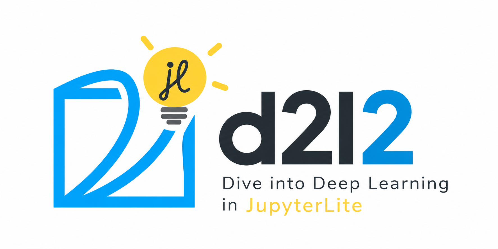

  

# d2l2

**Dive into Deep Learning, adapted for JupyterLite.**

d2l2 is an experimental, browser-native adaptation of [Dive into Deep Learning (D2L)](https://d2l.ai/), designed to make its educational content and interactive examples accessible through [JupyterLite](https://jupyterlite.readthedocs.io/) without requiring a local Python installation or a remote computation server.

The last "2" in "d2l2" does not refer to a version 2 of D2L but to the letter "l" of "lite": (D)ive into (D)eep (L)earning, adapted for Jupyter(L)ite.

The project aims to preserve D2L's chapter structure, mathematical explanations, learning objectives, and exercises while adapting its framework-dependent Python implementations for execution directly in the browser.

**Project status:** Early development. Compatibility assessment is underway; adapted chapters and executable notebooks are not yet available.

## Motivation

Dive into Deep Learning is an open-source, interactive textbook combining mathematical explanations with executable code.

Its implementations rely primarily on deep learning frameworks such as PyTorch, TensorFlow, JAX, and MXNet. These environments can be difficult to reproduce in a browser-only Python runtime.

d2l2 explores whether the same educational progression can be maintained using lightweight, browser-compatible implementations.

The objective is not to reproduce the entire deep learning framework ecosystem in the browser, but to make the underlying concepts accessible through executable, pedagogically faithful examples.

## Design Principles

- **Educational fidelity:** Preserve D2L's explanations, mathematical formulations, learning objectives, and exercises wherever possible.
- **Browser-native execution:** Run examples entirely in the browser without requiring a remote Python kernel.
- **NumPy first:** Prefer NumPy implementations when they adequately illustrate the underlying concepts.
- **Framework independence:** Avoid unnecessary dependencies on full deep learning frameworks.
- **Progressive adaptation:** Adapt chapters individually, prioritizing educational value and technical feasibility.
- **Reproducibility:** Document runtime requirements, implementation differences, and compatibility limitations.

## Technical Approach

### JupyterLite

d2l2 targets JupyterLite with two Python execution environments:

- **Pyodide:** Python compiled to WebAssembly, with access to a browser-compatible scientific Python ecosystem.
- **xeus-python:** A browser-native Python kernel built using WebAssembly.

Compatibility will be evaluated independently for each environment.

### NumPy and Deep Learning

Where practical, framework-specific operations will be replaced with NumPy equivalents.

This includes tensor manipulation, linear algebra, probability, optimization, and selected neural network implementations.

Some chapters may require more substantial adaptation, particularly those involving automatic differentiation, GPU acceleration, large datasets, or computationally expensive training.

The goal is to preserve the concepts being taught rather than provide identical framework APIs.

### Transformers.js and lmLite

For selected chapters involving modern language models or inference, d2l2 may explore integration with [Transformers.js](https://huggingface.co/docs/transformers.js/) through [lmLite](https://github.com/decitre/lmlite).

lmLite provides Python access to browser-native machine learning inference.

This integration is optional and is not intended to replace the mathematical and algorithmic foundations of D2L.

## Compatibility Assessment

An initial static audit of the D2L source repository has been developed to identify:

- Framework-specific implementations and dependencies.
- Candidate chapters for direct adaptation.
- Potential incompatibilities with browser-native Python runtimes.
- Estimated adaptation effort.
- Opportunities for alternative browser-native implementations.

The audit distinguishes static compatibility estimates from actual execution results.

**Static analysis does not establish that a chapter runs successfully in JupyterLite.** Browser execution and educational fidelity must be validated separately.

The initial audit references D2L commit:

`23d7a5aecceee57d1292c56e90cce307f183bb0a`

## Initial Development Plan

The first phase will focus on three representative D2L chapters:

| Chapter | Focus |
|---|---|
| `chapter_preliminaries/ndarray.md` | Array operations and tensor fundamentals |
| `chapter_linear-regression/synthetic-regression-data.md` | Synthetic datasets and numerical computation |
| `chapter_attention-mechanisms-and-transformers/attention-scoring-functions.md` | Attention mechanisms and scoring functions |

The PyTorch implementations will serve as the primary reference.

Each adaptation will be reviewed for educational fidelity, browser compatibility, dependencies, and reproducibility.

The project will progressively expand to additional chapters based on the results of these initial experiments.

See [ROADMAP.md](ROADMAP.md) for further details.

## Relationship to Dive into Deep Learning

d2l2 is an independent adaptation of the original [Dive into Deep Learning](https://github.com/d2l-ai/d2l-en) project.

It is not an official D2L edition and is not affiliated with or endorsed by the original authors.

The project intends to preserve the educational contributions of D2L while adapting selected implementations for browser-native execution.

Adapted chapters will identify their original sources and document substantive modifications.

## License and Attribution

The original Dive into Deep Learning book content is distributed under the [Creative Commons Attribution-ShareAlike 4.0 International License](https://creativecommons.org/licenses/by-sa/4.0/).

Adapted educational content derived from D2L will retain the applicable attribution and ShareAlike requirements.

Source code and third-party materials may be subject to separate licenses. These will be reviewed and their required notices preserved before redistribution.

See [CONTENT-LICENSE.md](CONTENT-LICENSE.md) and [NOTICE.md](NOTICE.md) for licensing and attribution details.

## Feedback and Contributions

d2l2 is an experimental project exploring browser-native deep learning education.

Feedback is particularly welcome on:

- The educational usefulness of framework-independent implementations.
- The fidelity of NumPy adaptations to the original D2L examples.
- JupyterLite compatibility, performance, and runtime limitations.
- Opportunities for browser-native machine learning beyond traditional Python frameworks.

Please share suggestions, bug reports, and use cases through [GitHub Issues](https://github.com/decitre/d2l2/issues).
